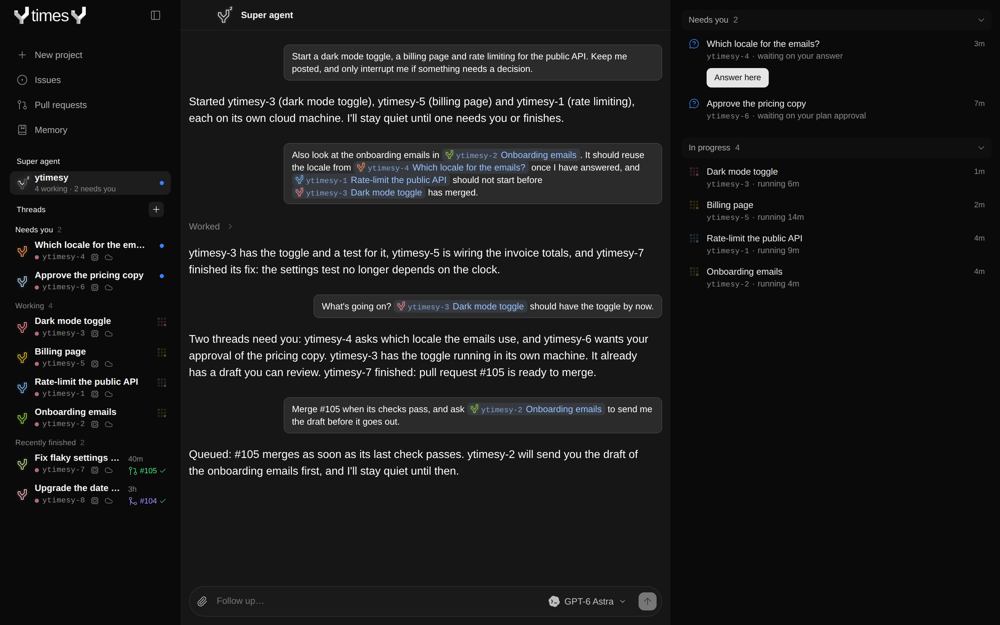
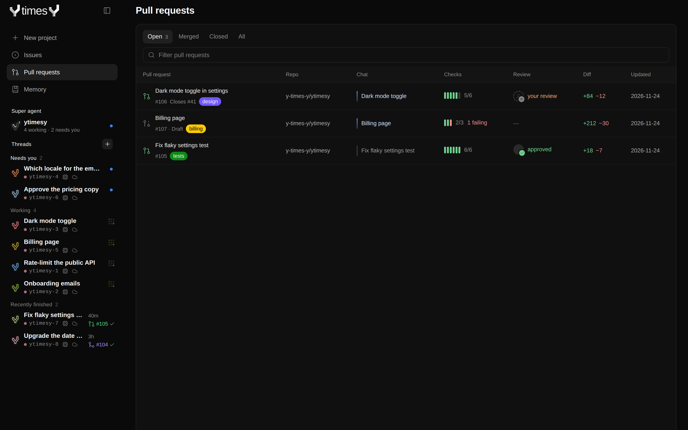
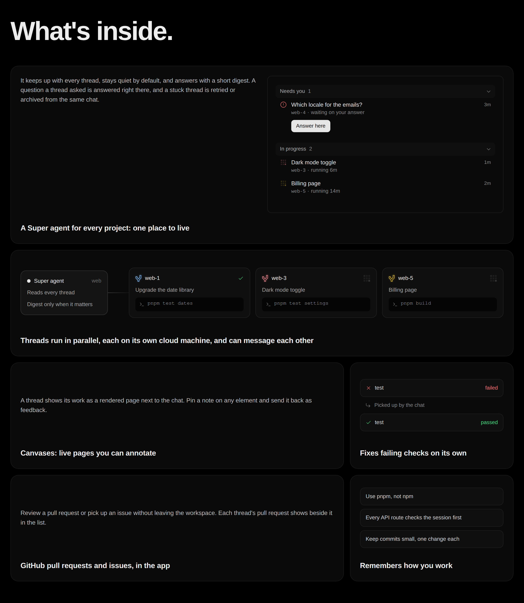
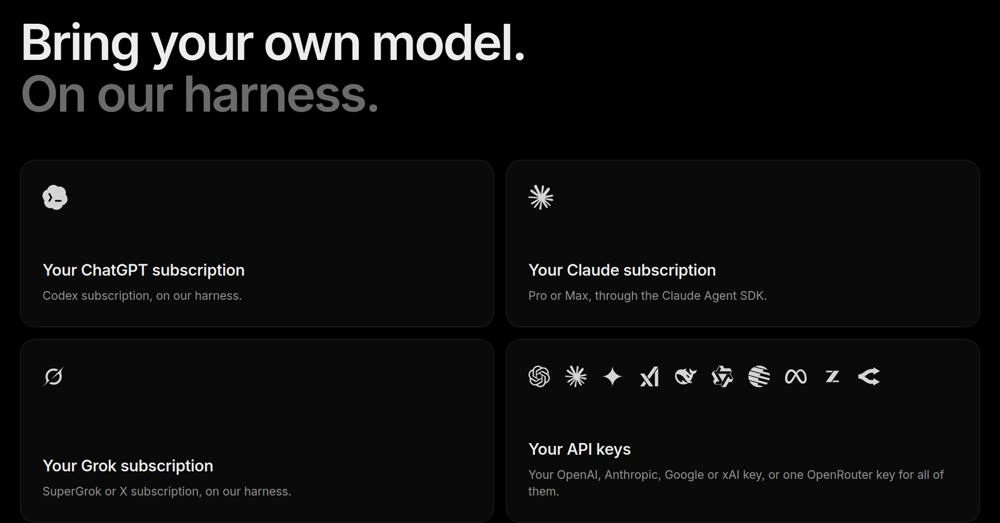
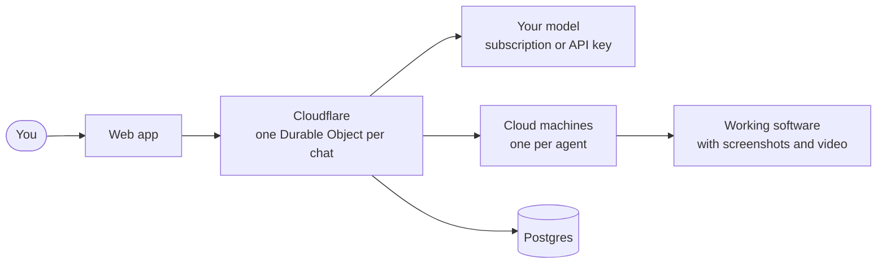

<div align="center">

<picture>
  <source media="(prefers-color-scheme: dark)" srcset="public/brand/mark-light.svg">
  
</picture>

# ytimesy

### AI Software Engineer in the Cloud

[](LICENSE)
[](https://discord.gg/8rhTdsrtGw)
[](https://ytimesy.com)

[**Website**](https://ytimesy.com) · [**Discord**](https://discord.gg/8rhTdsrtGw) · [**Architecture**](docs/architecture.md) · [**Contributing**](CONTRIBUTING.md)



</div>

---

## Why ytimesy

- **Parallel agents, separate machines.** A lead agent plans and splits the work. Builders write code in parallel, each on its own cloud machine with its own working tree, terminal and preview, so they never collide.
- **Tested in a real browser.** Verifier agents open the running app, click through it and capture screenshots and a screen recording.
- **Proof, not promises.** Screenshots, a screen recording and test results come with the work, and every completed turn is saved to its own branch so you can review, steer or roll back.
- **Fixes its own failing checks.** When a test fails, the chat picks it up and keeps going.
- **Remembers how you work.** "Use pnpm, not npm" is learned once and kept.
- **Keeps working when you leave.** Close the tab; the work continues and you reconnect later.
- **Bring your own subscription or API key.** Use your ChatGPT, Claude or Grok subscription, or your own API keys, on one harness. Nothing silently falls back to paid inference.

<div align="center">

<br>
<sub>The workspace: the Super agent, threads grouped by what needs you, and pull requests in the app (Issues sit above them). Rendered from the app's own components with demo data by <code>pnpm previews</code>.</sub>
</div>

## What's inside

<div align="center">

</div>

## Bring your own model

<div align="center">

</div>

## How it works



A chat is owned by a Durable Object that runs each turn one model step at a time and resumes after a deploy instead of failing. Every agent gets its own machine copied from your project's prepared snapshot. The full picture, with sequence diagrams and a code map, is in **[docs/architecture.md](docs/architecture.md)**.

## Repository layout

| Path | What it is |
|---|---|
| `src/` | The web app (TanStack Start, React) and the server: harness loop, tools, adapters |
| `packages/ytimesy-cli` | The `ytimesy` CLI, which moves your local agent sessions into ytimesy |
| `src/local-sessions` | Readers for local sessions: Claude Code, Codex, Cursor, Gemini CLI, OpenCode, Pi, Grok |
| `supabase/migrations` | Database schema |
| `wrangler.*.jsonc`, `infra/` | Cloudflare Workers and deployment configuration |
| `benchmarks/`, `evals/` | Benchmark and evaluation harnesses |
| `docs/` | Architecture and design notes |
| [`PLAN.md`](PLAN.md) | Product scope, stack and module boundaries |

## Getting started

**Use it:** the hosted product is free in beta at **[ytimesy.com](https://ytimesy.com)**.

**Move a local session to it:**

```sh
npx -y ytimesy@latest --help
```

See the [CLI README](packages/ytimesy-cli/README.md). It needs Node.js 22.13 or newer and works on macOS, Linux and Windows.

**Work on the code:**

```sh
git clone <this repository> ytimesy && cd ytimesy
corepack enable
pnpm install --frozen-lockfile
pnpm test        # vitest
pnpm lint        # biome
pnpm typecheck
```

> **Self-hosting is not supported yet.** The full app needs a Postgres database, Cloudflare Workers and Durable Objects, a Freestyle account and a GitHub App; `.env.example` lists the settings. The development server is currently wired to the maintainers' development environment. Making it runnable from a fresh clone is on the roadmap, and help is welcome (see [CONTRIBUTING.md](CONTRIBUTING.md)).

## Community

Questions, ideas, show-and-tell and help getting set up: **[join the ytimesy Discord](https://discord.gg/8rhTdsrtGw)**.

Found a bug? [Open an issue](../../issues). Found a security problem? Please follow [SECURITY.md](SECURITY.md) and do not post it publicly.

## Contributing

Small, focused pull requests are easiest to review. Read [CONTRIBUTING.md](CONTRIBUTING.md) and [PLAN.md](PLAN.md) first, and say hello on Discord before starting anything large.

## Licence

[MIT](LICENSE) © 2026 ytimesy
