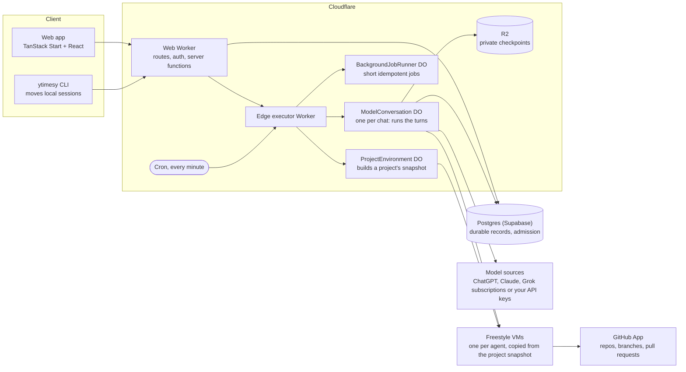
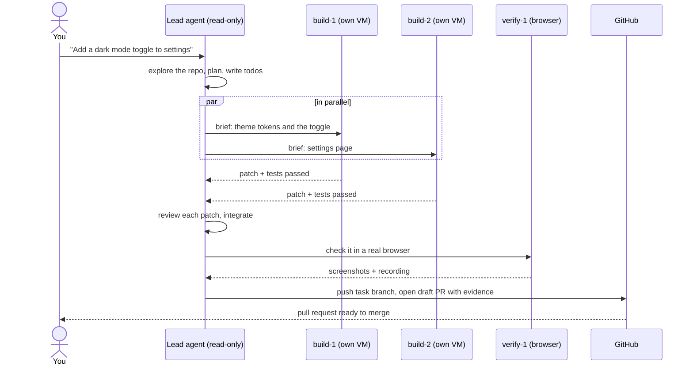

# Architecture

ytimesy is where software gets built with AI engineers. A **lead** agent plans and splits the work, **builder** agents write code in parallel, each on its own cloud machine, and **verifier** agents check the result in a real browser, with screenshots and video as proof.

This page is the map. The decisions behind it live in [PLAN.md](../PLAN.md), [Cloudflare execution model](edge-architecture-migration.md#cloudflare-execution-model-decision-2026-10-12) and [Where Claude Code runs](claude-code-placement.md).

## The system

| Piece | What it does |
|---|---|
| **Web app** (`src/routes`, `src/features`) | Server-rendered UI: chat, Diff, Terminal, Desktop, Memory, settings. Routes stay thin. |
| **Web Worker** (`wrangler.web.jsonc`) | Authentication, GitHub and project server functions, admission of new turns. |
| **ModelConversation** (Durable Object) | Owns one chat. Runs the turn **one model step per alarm** with SQLite step receipts, streams progress to the browser, and resumes after a deploy or eviction instead of failing. |
| **BackgroundJobRunner** (Durable Object) | Short on-demand jobs: turn admission, peer messages, checkpoints, environment admission. Idempotent by job ID. |
| **ProjectEnvironment** (Durable Object) | Clones, installs and verifies a project, then snapshots it. Long commands run detached on the VM. |
| **Cron** | Every minute: reconcile, supervise, deliver, checkpoint, PR repair and similar housekeeping. |
| **Postgres** | Durable records and cross-conversation admission. The source of truth. |
| **Freestyle VMs** | Each agent gets its own machine with a working tree, terminal and desktop, copied from the project's prepared snapshot. |
| **GitHub App** | Selected-repository access; each completed turn is committed and pushed to its own task branch, and a draft PR is opened. |
| **Model sources** | Your ChatGPT (Codex), Claude or Grok subscription, or your own API keys. API keys are encrypted at rest. |

## One task, end to end

A few rules the system holds to:

- **The lead never edits.** New chats start as read-only leads; a code change needs a fresh read-write builder.
- **Every writer has its own machine**, working tree, ports and preview, so parallel agents cannot collide.
- **Work survives the browser.** Close the tab, come back later; the chat keeps running and reconnects.
- **Bookkeeping never blocks you.** Usage accounting, analytics and logging may fail without failing the action.
- **Nothing silently falls back to paid inference.** You choose the model source.

## Code map

| Path | Responsibility |
|---|---|
| `src/routes` | Navigation, request validation, auth boundary. No provisioning logic. |
| `src/features/*` | UI by feature: projects, sessions, workspace, landing, onboarding. |
| `src/domain` | Models, state transitions and pure policies. No React, HTTP or provider SDKs. |
| `src/server/services` | Workflows: project setup, session lifecycle, publication, recovery. |
| `src/server/adapters` | Freestyle, GitHub, database, model providers, jobs. Provider details stay here. |
| `src/server/jobs` | Durable job handlers, including the model loop (`api-turn.ts`). |
| `src/server/auth` | Identity, tenant membership, repository permissions. |
| `src/local-sessions` | Readers for local agent sessions, used by the CLI hand-off. |
| `packages/ytimesy-cli` | The published `ytimesy` CLI. |
| `supabase/migrations` | Database schema. |

Dependency direction: UI → authenticated server entry → service → capability → adapter.
