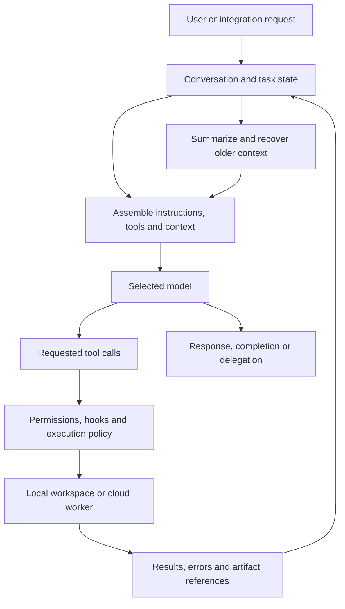

# Cursor harness: detailed public architecture

Research date: October 6, 2026. Primary sources read with agent-browser. This is a reconstruction from Cursor's documentation, engineering posts, and a staff explanation, not an inspection of private implementation or an authenticated product test. Performance figures below are Cursor's reported measurements, not independently reproduced results. Older posts are dated deliberately because the architecture changes.

## 1. What the harness owns

The model generates reasoning, messages, and requests to call tools. Cursor supplies instructions, chooses which tools and context are available, executes permitted actions, adds their results to the next request, and manages continuation. Its SDK exposes the same harness family through desktop, CLI, web, local execution, cloud VMs, and self-hosted workers. Execution locations and supported capabilities differ; this does not imply identical behavior on every surface.

Sources: [Agent overview](https://cursor.com/docs/agent/overview), [SDK announcement, April 29](https://cursor.com/blog/typescript-sdk).

Conceptual architecture, not Cursor's literal internal module names:

The repeated request/tool-result cycle is explained by Cursor's [tool-calling guide](https://cursor.com/learn/tool-calling). The model proposes an action in structured form; application code performs it. Reading a file does not modify model weights: it supplies text for subsequent inference.

## 2. Context is constructed, not omniscient

Public prompting docs identify system instructions, tool definitions, rules, skill descriptions, MCP information, subagent documentation, summaries, conversation messages, and tool results as context components. Users can attach files, directories, terminals, chats, diffs, and browser context. Selected information enters the request; the entire repository is not automatically present.

Cursor's April engineering post describes a shift away from heavy static repository injection and mandatory guardrails. OS, Git state, and current/recent files remain useful initial context. Models increasingly decide which additional information to fetch. Earlier behavior such as injecting diagnostics after every edit, extending short file reads, and capping tool calls should not be assumed current.

Sources: [Prompting](https://cursor.com/docs/agent/prompting), [Harness engineering, April 30](https://cursor.com/blog/continually-improving-agent-harness).

## 3. Current code search versus historical semantic search

Current Search docs describe Instant Grep: a custom exact-match/regex engine with a local index. Cursor says code and file paths are not uploaded to construct that index and codebase embeddings are not stored for search. File contents opened from matches can still enter inference requests.

A July 22 staff post confirms semantic indexing is being turned down in favor of grep retrieval. The model can try candidate terms in parallel, list directories, read matches, and refine its query. This makes retrieval an iterative model/tool interaction.

Sources: [Current Search](https://cursor.com/docs/agent/tools/search), [Cursor staff explanation](https://forum.cursor.com/t/what-do-you-think-about-cursor-removing-the-codebase-indexing-settings/165899/10).

Historically, Cursor described trained embeddings and hybrid grep/semantic retrieval in its November 6, 2025 [semantic-search research](https://cursor.com/blog/semsearch). That research is useful history, not proof of today's architecture. The April SDK announcement also lists semantic search; current dedicated Search docs and the subsequent staff explanation are more recent evidence.

There is no public evidence here for a current universal repository knowledge graph or its implementation.

## 4. Large outputs become searchable files

Cursor's January context-discovery post describes storing long shell/MCP results in files rather than discarding their contents through truncation. The agent receives a reference and selectively reads relevant portions. Integrated terminal histories are also available as files. After summarization, a history-file reference lets the agent recover omitted details.

The distinction matters: information can remain recoverable without occupying the active model context. Browser documentation similarly describes file-backed logs, previews, and line counts that help the agent choose what to inspect.

Sources: [Dynamic context discovery, January 6](https://cursor.com/blog/dynamic-context-discovery), [Browser](https://cursor.com/docs/agent/tools/browser).

## 5. Tool discovery and prompt caching

The September 23 efficiency post describes keeping common read/search/edit/shell tools in static context and loading less frequent built-in tools dynamically. MCP tools had already moved to dynamic discovery. A question tool remains explicit for models that otherwise hallucinated it; Plan Mode retains its essential plan tool.

Stable definitions and instructions sit before cache boundaries. Variable setup, including environment information, skills, and subagent information, moves to a synthetic user message after those boundaries. The post reports explicit cache breakpoints for supported OpenAI models. It also describes numbering file reads every tenth line rather than every line and reducing over-encouragement of subagent use. Child model overrides require direction from the user or harness.

Cursor reports an overall 7% cost reduction, approximately 66% shorter system prompts, 60% fewer static built-in tool-description tokens, and 20% fewer cold cache misses. These measure different denominators and must not be added together.

Source: [Improved token efficiency, September 23](https://cursor.com/blog/improved-token-efficiency).

Caching reuses computation for repeated request prefixes; it is distinct from memory, summaries, or avoiding a file read.

## 6. Compaction and Composer self-summarization

As a conversation grows, Cursor compresses older context. Dynamic context discovery preserves a route back to underlying history. Exact thresholds and prompts for every currently supported provider are private.

Composer has a specifically published training mechanism: reach a token trigger, inject a summary request, let Composer produce condensed context, then continue using that summary plus state such as the plan and remaining tasks. Summarization is part of reinforcement-learning trajectories, so the eventual reward trains both task actions and summaries. The model learns what information needs to survive.

The March study used 40k and 80k triggers and reported roughly 1,000-token summaries versus roughly 5,000 for its baseline. These are experimental settings and averages, not a universal current Cursor limit. Cursor reports fewer compaction errors in those experiments.

Sources: [Prompting](https://cursor.com/docs/agent/prompting), [Dynamic discovery](https://cursor.com/blog/dynamic-context-discovery), [Training Composer for longer horizons, March 17](https://cursor.com/blog/self-summarization).

A summary is lossy. A retrievable transcript does not ensure the model will notice and retrieve every missing detail.

## 7. Per-model tools and mid-chat switching

Cursor tunes prompts and tool formats for providers and individual model versions. Its published example gives OpenAI models patch editing and Anthropic models string replacement, matching their training conventions.

On a model switch, the prompts and tools change. Extra instructions tell the incoming model it is taking over and discourage obsolete tools visible in history. Cross-provider/model caches do not transfer; summarizing at the switch can reduce input cost but lose details. A separate subagent can use another model without transplanting the entire conversation.

Source: [Harness engineering](https://cursor.com/blog/continually-improving-agent-harness).

These are documented examples, not a complete list of current schemas or provider-specific prompts.

## 8. Model routing

Cursor's August Router post describes two stages. Compass predicts turn complexity using current work and recent conversation/tool signals. A task taxonomy then selects among more capable models when justified, using observed outcomes across domains, tasks, and modifiers.

Eligible choices are optimized against cost budgets for different Auto modes. Training and evaluation use production outcomes inferred from subsequent user behavior, as well as API and token cost. Switching-related cache misses count toward cost. Offline cross-validation and held-out evaluation produce candidates; production tests assess them.

Source: [How Cursor Router works, August 6](https://cursor.com/blog/how-cursor-router-works).

This describes Auto routing; it does not establish that every explicitly selected model is silently replaced, or that routing happens after every individual tool call.

## 9. Subagents and isolation

Subagents start with independent context and need a properly scoped assignment from the parent. Built-ins include Explore, Bash, and Browser. Explore isolates broad searches; Bash isolates command output; Browser isolates visual/browser interactions. The parent gets findings rather than all intermediate material.

Foreground calls wait; background calls return while the child continues. Agent IDs permit resuming preserved child context. Custom agents can specify instructions, models, read-only behavior, or background execution.

Context isolation is separate from filesystem isolation. Agents normally share the checkout; optional worktree or cloud VM/branch isolation provides separate execution state. The parent must reconcile changes. Local parents can delegate to cloud children.

Source: [Subagents](https://cursor.com/docs/subagents).

Costs include repeated setup, duplicated work, merge conflicts, and integration effort. Exact automatic-delegation policies and capacity limits are not publicly specified.

## 10. Rules, skills, MCP, and hooks

These mechanisms have different jobs:

| Mechanism | Function | Important boundary |
| --- | --- | --- |
| Rules / AGENTS.md | Instructions included according to scope and applicability | Prompt guidance, not OS permissions |
| Skills | Discoverable procedures with scripts, templates, and references | Workflow knowledge, not a separate agent |
| MCP | Protocol connecting external tools and data | Execution/authentication depends on the server and policy |
| Hooks | User/team code invoked at lifecycle and tool boundaries | Script failure policy determines enforcement |

Rules support always-on, path-scoped, relevance-selected, and manually attached behavior. Skills load resources progressively. MCP supports local stdio and remote transports, plus tools, resources, prompts, and authentication flows.

Sources: [Rules](https://cursor.com/docs/rules), [Skills](https://cursor.com/docs/skills), [MCP](https://cursor.com/docs/mcp).

Hooks exchange JSON over stdio and can inspect, block, or modify supported actions. Events cover tool calls, file operations, subagents, compaction, and completion. `preCompact` observes rather than changes compaction. Invalid permission-hook responses block, but crashes/timeouts generally allow unless fail-closed behavior is configured. Cloud support is a subset: command hooks load from repository/team settings, not the laptop's personal configuration; hooks do not run during initial read-only cloud exploration.

Source: [Hooks](https://cursor.com/docs/hooks).

## 11. Local permissions and actual sandboxing

Current Run Modes describe Auto-review, Allowlist, and Run Everything. Auto-review first handles allowlisted actions, then sandboxable shell commands, then sends other relevant calls to a backend classifier. That classifier can inspect scripts with read-only tools. A blocked action can cause a different approach or a human approval request.

The classifier is explicitly not a security boundary. `permissions.json` provides policy guidance; `sandbox.json` configures reachable paths/network resources. Execution outside the sandbox has different authority.

Source: [Run Modes](https://cursor.com/docs/agent/security/run-modes).

The March sandbox engineering post specifies macOS Seatbelt via `sandbox-exec`, Linux Landlock plus seccomp and filesystem overlays, and the Linux sandbox inside WSL2 on Windows. Tool descriptions explain restrictions; error results identify sandbox failures so the model can request the appropriate permissions instead of repeatedly retrying.

Source: [Local sandbox implementation](https://cursor.com/blog/agent-sandboxing).

Ignore handling depends on the tool and execution mode. The general ignore docs warn that terminal/MCP tools can access files excluded from native reads. Sandboxed command execution can enforce additional filesystem restrictions. `.cursorignore` alone is not a universal access-control guarantee.

Source: [Ignore files](https://cursor.com/docs/context/ignore-files).

## 12. Cloud environments, Builds, and snapshots

Cursor-hosted cloud agents receive dedicated Firecracker-based microVM environments. Repository authorization combines installation of Cursor's Git provider app with the triggering user's existing repository access. Environments include dependencies, secrets, and network policies.

Sources: [Cloud security](https://cursor.com/docs/cloud-agent/security), [Environment setup](https://cursor.com/docs/cloud-agent/setup).

Builds move clone/install work ahead of agent startup. A successful prepared disk snapshot becomes active; failed builds leave the previous successful build available. Prewarmed copies reduce startup work. Feature runs check out the requested branch after boot; default-branch freshness follows the configured policy.

Builds save disk state, not running processes, shell exports, or in-memory caches. Services start through `start`/`terminals`. Build-time team/environment secrets differ from user secrets injected at run time. Self-hosted machines do not boot Cursor Builds.

Source: [Builds](https://cursor.com/docs/cloud-agent/builds).

A prepared environment snapshot, a runtime hibernation snapshot, and an editor code checkpoint are different artifacts with different restoration behavior.

## 13. Durable cloud execution

Cursor's June post says its cloud agent loop uses Temporal for retries, scheduling, and continuity across infrastructure/provider failures. Workflows became shorter and task-scoped to simplify upgrades; activities were separated to manage timeouts and async work.

Agent execution, machine state, and conversation state are separate. An append-only storage/streaming layer tracks retried partial output, letting clients rewind and replace abandoned streams. VMs can hibernate, resume, or fork independently of the loop. Computer-use subagents have their own routing/prompts/recording while sharing environmental browser/VNC resources with the parent.

Source: [Cloud agent lessons, June 2](https://cursor.com/blog/cloud-agent-lessons).

Temporal adoption alone does not prove exactly-once shell commands, commits, deployments, or other external effects. Cursor has not published all replay/idempotency contracts. The exact distinction between disk snapshots and full process-state restoration also depends on the runtime feature; do not infer it from the word snapshot alone.

## 14. Self-hosted workers

Execution can move into customer-managed machines while planning and inference remain in Cursor's cloud. A worker opens an outbound HTTPS connection, receives tool calls, executes them against the working copy, and returns results.

Named pools provide queues; controllers use team-supplied spawning scripts to add machines. Idle and reconnect policies allow reset, preservation, or hibernation. Pool infrastructure can support Macs, GPUs, Kubernetes, or sandbox providers.

Source: [Self-hosted machines, September 2](https://cursor.com/blog/self-hosted-machines).

Self-hosting execution is not self-hosting the complete harness or inference service. Returned outputs can contain code and transcripts can be processed/stored by Cursor.

## 15. Five distinct persistence mechanisms

| Mechanism | What survives | Scope |
| --- | --- | --- |
| Conversation transcript | Messages, tool calls, results and artifacts | One conversation |
| Summary + history lookup | Condensed working state with access to older history | Continuation of that conversation |
| Repository rules/skills | Explicit instructions and procedures | Applicable repository/user/team scope |
| Project shared files | Research, artifacts, learned procedures and preferences | Agents participating in a Project |
| Automation Memories | Named entries, default `MEMORIES.md` | Successive runs of the same automation |

Projects use a coordinator that plans/delegates rather than edits code directly. Shared files synchronize across participating cloud/local machines, preserving context over months. Requested subscriptions let the coordinator react to schedules and external work signals.

Automation memories live outside the working filesystem, can be edited/deleted, and are distinct from a normal transcript. Conversation search uses a local transcript index; existence of that index does not mean every new independent chat automatically receives all prior discussions.

Sources: [Projects](https://cursor.com/docs/agent/projects), [Automations](https://cursor.com/docs/cloud-agent/automations), [Agent overview](https://cursor.com/docs/agent/overview).

Public docs do not disclose Project file formats, storage databases, or a universal memory-retrieval algorithm.

## 16. Verification, review, rollback, and steering

The agent can execute builds/tests, interact with browser UI, inspect screenshots, and diagnose console/network output. These are capabilities; their availability does not prove every task receives adequate testing.

Plan Mode explores and produces a reviewable plan before implementation. Agent Review separately evaluates local changes at Quick or Deep depth and can run on demand or automatically. Current docs describe both task and commit triggers, so the exact automatic setting should be checked in the installed version.

Sources: [Browser](https://cursor.com/docs/agent/tools/browser), [Plan Mode](https://cursor.com/help/ai-features/plan-mode), [Agent Review](https://cursor.com/docs/agent/agent-review).

Local checkpoints restore file state and are separate from Git; restoring does not erase conversation messages. Queued instructions wait for completion, while steering delivers instructions at safe tool boundaries. Side chats keep their own transcript with parent reference context. `/goal` provides a longer-lived objective on supported surfaces.

Source: [Agent overview](https://cursor.com/docs/agent/overview).

## 17. Harness evaluation and production repair

Cursor evaluates model+harness combinations using public benchmarks, CursorBench, and online experiments. It measures latency, tokens, tool-call counts, and cache behavior, alongside edit retention and inferred user satisfaction.

Tool failures have classifications for bad arguments/environment mismatches, provider errors, user aborts, timeouts, and unknown failures. Alerts use tool/model baselines; unknown errors are treated as implementation bugs. Internal agents investigate logs and propose repairs.

Source: [Harness engineering](https://cursor.com/blog/continually-improving-agent-harness).

Code retention and inferred satisfaction are proxies, not proofs of correctness. A harness change can improve one metric while worsening another. Public claims do not establish superiority on your own workloads.

## 18. Model training feeds back into the harness

Composer is trained for execution inside Cursor's environment. Self-summarization trains continuity across context resets. Composer 2.5's targeted textual feedback supplies local training signals for mistakes such as invalid tools or communication problems, alongside whole-trajectory rewards. Synthetic tasks grounded in real codebases supply testable outcomes; Cursor also describes monitoring for reward hacking.

Sources: [Self-summarization](https://cursor.com/blog/self-summarization), [Composer 2.5](https://cursor.com/blog/composer-2-5), [Composer 2 technical report](https://arxiv.org/abs/2603.24477).

Cursor's March real-time RL post describes deriving reward from permitted production interactions, running regression evaluations, and deploying improved checkpoints. It also reports fixing incentives that encouraged broken tool calls or excessive clarification to avoid negative rewards.

Source: [Real-time RL](https://cursor.com/blog/real-time-rl-for-composer).

This does not mean all customer conversations train models. Cloud security docs say Cloud Agents run in Privacy Mode and their code, prompts, and responses are not used for training. Privacy settings and model-provider exceptions must be assessed separately from the training research.

Source: [Cloud privacy and security](https://cursor.com/docs/cloud-agent/security).

## 19. An illustrative end-to-end task

For a request such as "fix the login redirect and test it":

1. Cursor opens/resumes the conversation and selects the model/mode.
2. It assembles applicable instructions, context, and tool definitions.
3. The model searches redirect/auth symbols, reads candidate code, and updates its understanding.
4. Broad exploration may go to a child whose findings return to the parent.
5. The model proposes an edit through its provided editing format.
6. Hooks and execution policy apply to relevant tool calls.
7. The model runs tests, reads errors, and iterates; browser tools can verify the visible flow.
8. Large results remain searchable in files; growing context can be summarized.
9. The user can steer the task at a safe boundary.
10. The agent presents a diff/result; configured review or a cloud PR provides handoff.

This is an illustrative synthesis of documented capabilities, not a guaranteed hardcoded state machine or a reproduced run. The model may omit steps or decide on a different order.

## 20. What remains private

The complete source code, system prompts, all per-model tool schemas, tokenizer/budget policies, automatic delegation heuristics, internal databases, retry/idempotency contracts, queue scheduling, and most detailed rollout/evaluation datasets are unavailable here. Public material supports an architecture-level explanation, not an exact reimplementation.

The most consequential published design is the combination: model-specific interfaces, selective context access, stable cached request prefixes, independent child contexts, real development environments, durable execution, user steering, and measurement of actual outcomes.
